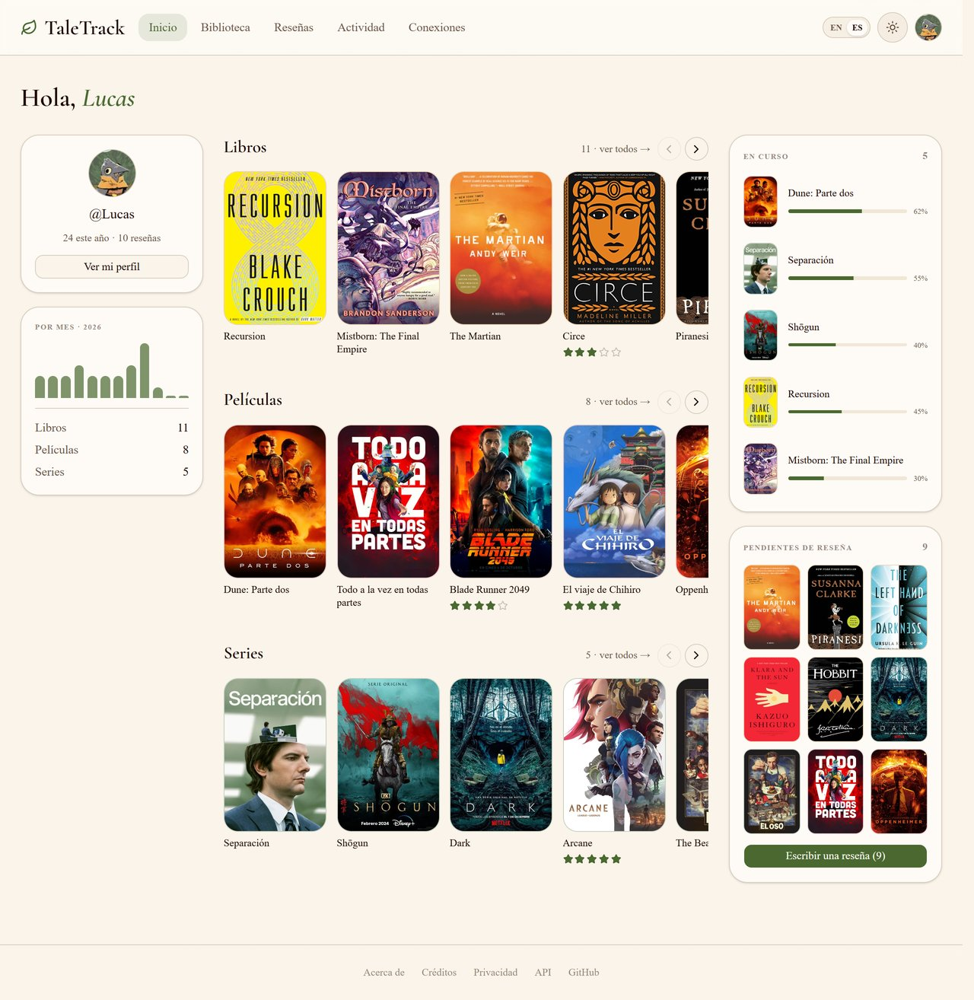
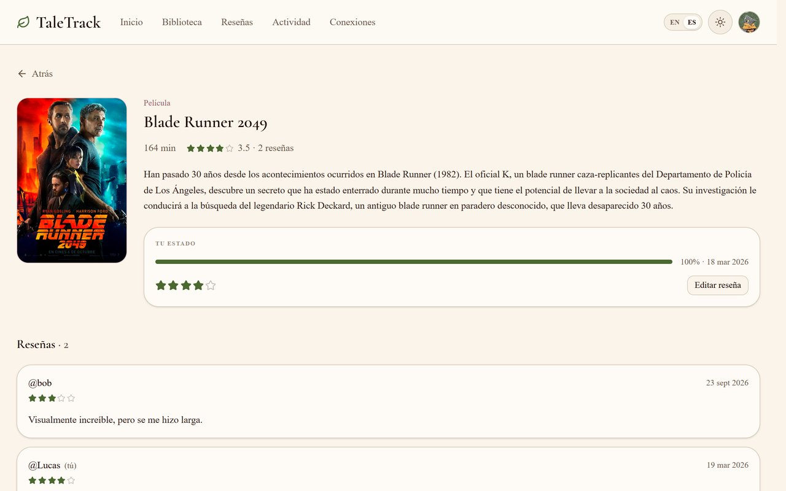
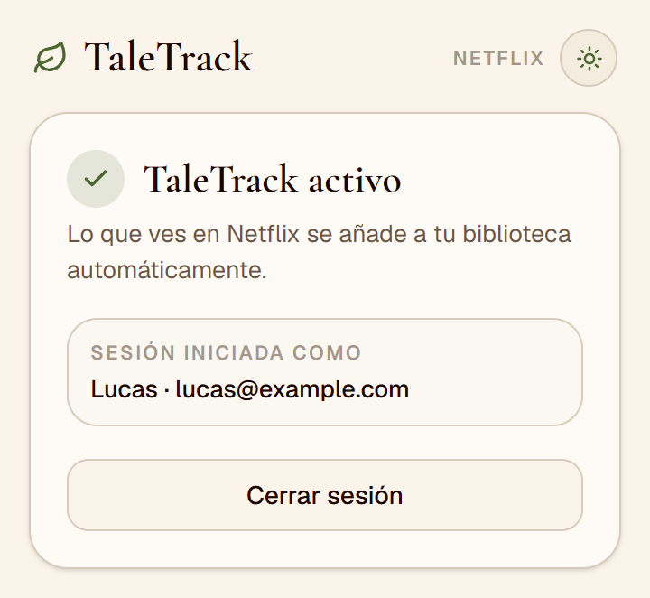
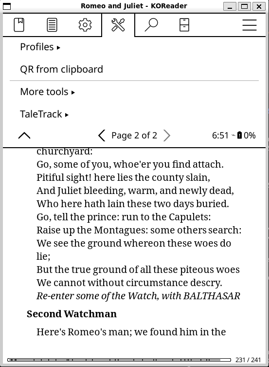
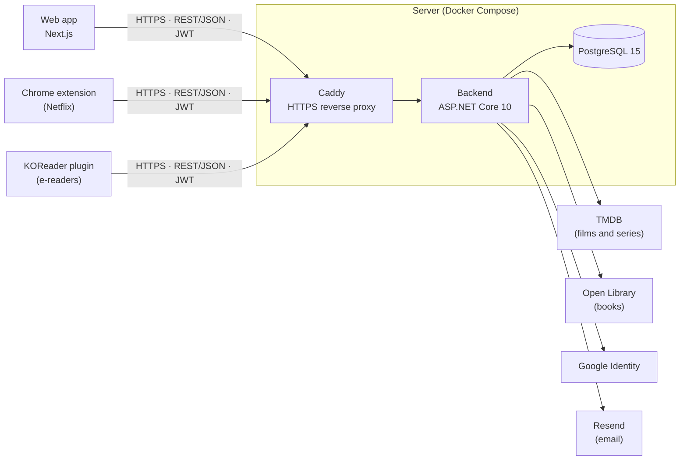

# TaleTrack

**Track the films, series and books you get through, without logging them by hand.**

[](https://github.com/ElPandaP/TaleTrack/actions/workflows/ci.yml)
[](https://github.com/ElPandaP/TaleTrack/actions/workflows/codeql.yml)
[](LICENSE)

[Live app](https://taletrack.app) (currently offline) · [Code documentation](https://elpandap.github.io/TaleTrack/) · [Downloads](https://github.com/ElPandaP/TaleTrack/releases/latest)

TaleTrack keeps a single library of everything you watch and read. A Chrome extension notices what you are watching on Netflix, a KOReader plugin notices what you are reading on your e-reader, and both report your progress to a shared backend. The web app then shows your library, lets you rate and review what you finished, and follows what your friends are up to.

It is my final degree project (TFG) at the School of Computer Engineering of the University of Oviedo (2026). It was deployed at [taletrack.app](https://taletrack.app), which is currently offline.

<p align="center">
  
</p>

## Why

Most tracking apps cover only one kind of media (one for books, another for films, another for series) and expect you to log every page or episode yourself. People forget, and the record drifts away from what they actually did. TaleTrack puts films, series and books in one place and captures progress automatically where the media is consumed, so the user only has to watch or read.

## Features

- **Automatic tracking on Netflix.** The extension detects the film or episode being played and reports progress while you watch. Reaching the end credits marks it as watched.
- **Automatic tracking on e-readers.** The KOReader plugin reports reading progress and marks the book as finished when you reach its last pages. Without network access, updates are queued and sent once the device is back online.
- **One library for everything.** Films, series and books with posters, synopses and authors, filled in automatically from TMDB and Open Library. The same title is never stored twice, even when it arrives in different languages or from different clients.
- **Reviews and social feed.** Star ratings and reviews, a list of finished items still waiting for a review, friend requests and an activity feed with per-media privacy settings.
- **Three ways to sign in.** Email and password, Google, or a one-time code sent by email (the method used on e-readers, where typing a password is awkward). Every device gets its own session, and sessions can be reviewed and revoked from the web.
- **Bilingual and responsive.** Spanish and English, light and dark themes, usable on a phone.
- **Open API.** The web app, the extension and the plugin all use the same public REST API, so anyone can build another client on top of it.

<p align="center">
  
</p>
<p align="center">
  
  &nbsp;&nbsp;
  
</p>

## Architecture



Everything revolves around the backend. The three clients are different entry points for data (the browser, Netflix and the e-reader) on top of the same API, and they all authenticate the same way, with a short-lived JWT and a rotating refresh token per device.

| Folder | What it is | Stack |
|---|---|---|
| [`TaleTrackApp/`](TaleTrackApp/README.md) | REST API: accounts and sessions, tracking, library, reviews, friends and activity, metadata enrichment | C#, ASP.NET Core 10 Minimal APIs, EF Core, PostgreSQL |
| [`TaleTrackApp.Tests/`](TaleTrackApp/README.md) | Integration tests that run the whole API in memory | xUnit, WebApplicationFactory, SQLite, coverlet |
| [`taletrack-frontend/`](taletrack-frontend/README.md) | Web app | TypeScript, Next.js 16 (App Router), React 19, Tailwind CSS 4, shadcn/ui |
| [`taletrack-netflix-extension/`](taletrack-netflix-extension/README.md) | Chrome extension that tracks Netflix | TypeScript, Manifest V3, Bun |
| [`taletrack.koplugin/`](taletrack.koplugin/README.md) | KOReader plugin that tracks books | Lua |
| [`docs/`](docs/README.md) | Generator of the code documentation site | DocFX, TypeDoc, lua-language-server |

## Engineering highlights

- **Vertical slices (REPR).** Every backend feature is a folder with its request, endpoint and response, so each use case can be read in one place. Business rules live in services that the endpoints coordinate.
- **Sessions done properly.** 5-minute access tokens and 60-day refresh tokens that rotate on every use, with only their hash stored, a short grace period for duplicate refreshes and one revocable session per device. One-time email links (password reset, account deletion) use the same hashed-token approach.
- **Deduplication and enrichment.** Incoming items are matched by ISBN, then by title and author, then by title alone, comparing titles in both languages. Missing metadata is fetched from TMDB or Open Library in the background after the response, so a slow external service never delays or breaks tracking.
- **Resilient clients.** The plugin keeps an offline queue with the latest progress per book and tells transient failures (retry later) apart from permanent ones (discard). The extension throttles updates and forces a final send when the tab closes or the video changes.
- **Hardened API.** Per-IP rate limiting, input validation on every endpoint, security headers, and a global error handler that never leaks internals.
- **Automation.** GitHub Actions builds and tests every push (175 integration tests and the extension's unit tests), runs CodeQL, deploys to the server from the `deploy` branch and publishes the code documentation to GitHub Pages.

## Install the clients

Ready-to-use builds of the extension and the plugin are attached to the [latest release](https://github.com/ElPandaP/TaleTrack/releases/latest). Both connect to [taletrack.app](https://taletrack.app) (currently offline). To use them with your own server, build them as explained in their READMEs.

- **Netflix extension.** Download `taletrack-netflix-extension.zip` and unzip it. In Chrome, open `chrome://extensions`, turn on *Developer mode*, click *Load unpacked* and choose the unzipped folder. Then open the extension and sign in.
- **KOReader plugin.** Download `taletrack.koplugin.zip` and unzip it into KOReader's `plugins/` folder, so that you end up with `plugins/taletrack.koplugin/`. Restart KOReader and sign in from *Tools → TaleTrack* with the code sent to your email.

## Run it locally

You need Docker. On Windows, with PowerShell:

```powershell
./scripts/start-all.ps1          # starts postgres, backend, frontend and dozzle, then seeds a demo user
./scripts/start-all.ps1 -NoSeed  # same, without sample data
./scripts/start-all.ps1 -Down    # stops everything
```

Or by hand on any platform:

```bash
cp .env.example .env   # then fill in the variables (see below)
docker compose -f docker-compose.dev.yml up -d
```

| Service | URL |
|---|---|
| Web app | http://localhost:8090 |
| Backend and Swagger | http://localhost:8080/swagger |
| Logs (Dozzle) | http://localhost:9999 |

With sample data, you can sign in as `demo@taletrack.dev` / `demo1234`. The backend applies pending database migrations on startup. Each project's README explains how to run it outside Docker and how to point the extension or the plugin at a local server.

### Environment variables

All configuration lives in a `.env` file at the repository root, created from `.env.example`.

| Variable | Required | Purpose |
|---|---|---|
| `POSTGRES_USER`, `POSTGRES_PASSWORD`, `POSTGRES_DB` | Yes | Database credentials. |
| `JWT_SECRET` | Yes | Key the backend signs sessions with. Must be long and random. |
| `APP_BASE_URL` | Production | Public URL of the web app, used in email links. Defaults to the local address. |
| `SITE_ADDRESS` | Production | Domain(s) served by Caddy, comma-separated. Empty means `http://localhost`. |
| `GOOGLE_CLIENT_ID` | No | Enables sign-in with Google. |
| `RESEND_API_KEY` | No | Enables email (one-time codes, password reset, account deletion). |
| `TMDB_API_KEY` | No | Enables posters and metadata for films and series. |

## Deploy

`docker compose up -d --build` starts the production stack: PostgreSQL, the backend, the web app, Dozzle and [Caddy](https://caddyserver.com/). Caddy is the only entry point. It serves the web app on `/`, forwards `/api` to the backend and obtains and renews the Let's Encrypt certificate on its own. The backend and the web app publish no ports to the host.

1. Point a domain at the server and open ports 80 and 443.
2. Create `.env` from `.env.example` and set `SITE_ADDRESS=<your-domain>, www.<your-domain>` and `APP_BASE_URL=https://<your-domain>`.
3. Run `docker compose up -d --build`. Later deploys only need `docker compose up -d --build backend frontend`.

In this repository, the `deploy` workflow does this automatically on every push to the `deploy` branch.

## License

[MIT](LICENSE). TaleTrack is not affiliated with Netflix, KOReader, TMDB or Open Library. Film and series data is provided by [TMDB](https://www.themoviedb.org/) and book data by [Open Library](https://openlibrary.org/).
